# 交大／陽明交大 E3 數位教學平台沿革（2000–2026）

> 整理日期：2026-10-16
> 範圍：從 2000 年的 E.NCTU「交大網路校園」，到現行的 `e3p.nycu.edu.tw`，以及合校前陽明大學端的平台。
> 來源：Wayback Machine 存檔（CDX 索引與原始 HTML）、交大校史館、數位內容製作中心（DCPC）網站、教務處手冊與投影片、官方 YouTube、憑證透明度（CT）紀錄，以及 2026-10 的實際連線測試。
> 可信度標記：**【確認】** 表示有存檔原文、官方文件或系統回傳字串為證；**【推測】** 表示由間接證據推論。
> 互動網頁：[`e3-history.html`](e3-history.html)（時間軸、各代截圖瀏覽、eCampus III 與 Moodle 版本圖，單一檔案、圖片內嵌、可離線開啟）。
> 圖庫：用瀏覽器開 [`gallery.html`](gallery.html) 可以依年代瀏覽全部截圖。詳細考證在 [`notes/`](notes/)。

---

## 0. 一張表看完

| 世代 | 網址 | 期間 | 系統 | 開發／維運 | 技術 |
|---|---|---|---|---|---|
| **E.NCTU**（e1） | `e.nctu.edu.tw` | 2000-11 → 約 2003（2004-02 最後存檔） | 「交大網路校園」 | 理學院「網路學習研究中心」自行開發；教務處網路教務組推廣 | FreeBSD + PostgreSQL + PHP、Phorum 3.2.11 |
| **E2** | `e2.nctu.edu.tw/eCampus/` | 2002-09 → 2007-09 底（公告停用） | eCampus | 網路教務組 → DCPC；廠商【推測】為三趨科技的五校 e-Campus | ASP.NET（C#）、限 IE 6、ActiveX 上傳元件 |
| **E3（舊 E3）** | `e3.nctu.edu.tw/NCTU_E3/…` → `NCTU_E3P` → `NCTU_EASY_E3P/LMS2/3/31` | 2006-02 → 2019-09（最後正常存檔） | **eCampus III／e-Campus 3.0** | 教務處數位內容製作中心（DCPC）；底層產品與三趨科技的關係見 §6 | ASP.NET、IIS 6.0 → 8.5、frameset、只支援 IE |
| **New E3** | `e3new.nctu.edu.tw` | 2017-09 → 2021-01 | New e3 數位教學平台 | DCPC 以 Moodle 客製 | Moodle 3.3–3.7【推測】、自製佈景 `theme_dcpc` |
| **E3（合校）** | `e3.nycu.edu.tw` | 2021-01-29 → 2024-02；**伺服器至今仍在線** | E3 數位教學平台 | 教務處教學資源組 → 數位教學中心 | 同一套 Moodle 改網域，之後升到 3.8–3.10【推測】 |
| **E3@NYCU（e3p）** | `e3p.nycu.edu.tw` | 2024-02（112 學年第 2 學期）→ 今 | E3@NYCU／E3 數位教學平臺 | 數位教學中心 | 另建的新站：Moodle 4.0 → 4.1–4.3 → ≥4.5【推測】、Boost Union 佈景 |

**名稱的由來**：「E3」就是 **eCampus III**（e-Campus 3.0），也就是 e-Campus 第 3 代。2006-07 起舊 E3 的頁面標題固定是 `eCampus III v…`，校史館寫「e-Campus 3.0（e3）上線」，DCPC 則稱「交大e-Campus（簡稱e3）」。【確認】
之後每一代都沿用「E3」這個品牌：New E3（2017）、e3.nycu（2021）、e3p（2024）都是 Moodle，已經和 eCampus III 無關。

---

## 1. E.NCTU「交大網路校園」— `e.nctu.edu.tw`（2000–約 2003）

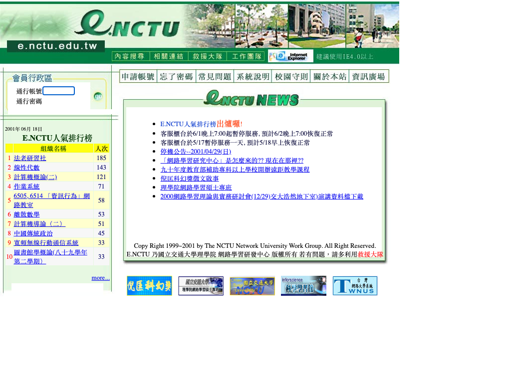
*2001-06 的 E.NCTU 首頁，左側是「E.NCTU 人氣排行榜」。來源：[Wayback 2001-06-19](https://web.archive.org/web/20010619061708/http://e.nctu.edu.tw/index_new.php)*

- **開發單位**：「網路大學推動小組」在 2000-06 成立，由魏哲和副校長召集，陳明璋博士任執行秘書。系統由理學院林松山院長領導的「網路學習研究中心」開發，教務處新成立的「網路教務組」（2000-11-01 設立，號稱全國首創）負責教務與推廣。【確認】
- **時程**：
  - 2000-07 開始開發。
  - 2000-10-17 辦「第一次網路教材設計實務研習會」，當時說平台「已開發完成…即將開放全校師生使用」。
  - **2000-11-04 V1.0 全面開放測試**。
  - 89 學年上學期正式啟用（校史館）。【確認】
- **技術**：「Server端均以Open Source Solution之軟體為採用重點」，即 **FreeBSD + PostgreSQL + PHP**；討論區是 Phorum 3.2.11；用戶端要求 IE 4.0 以上。【確認】
- **功能其實不只教材管理**：系統分成「個人工作室」和「組織建館」兩大塊。課程、行政單位、社團都算一種「組織」，底下有資源（教材）管理、檔案管理、**課業管理（出作業、繳作業、改作業及給分）**、Phorum 討論區、公告欄、行事曆、共用通訊錄。每人有 10MB 個人網頁空間，還有「藍色小精靈」線上說明。【確認】
  → 你在 `Profile.htm` 看到的「教材管理」是核心功能，但 2001 年的 V2.0 就已經有作業繳交與管理統計。
- **它的前身**：Profile 原文寫「E.NCTU 是『網路學習研究中心』所建構的第二個網站（第一個是數學學習館，informath.nctu.edu.tw）」。【確認】
- **衰退**：
  - 2002-10-15 有人在站上放 mp3 供人下載，接到 IFPI 通知。
  - 2002-10-18 移除個人資料夾的上傳功能，11/1 整個個人資料夾功能移除。
  - 最後一則公告在 2003-02-25（給科管所推廣教育學分班），最後一批內容存檔在 2004-02-12。【確認】
- **網域後來的去向**：
  - 2006-05-20 起，`e.nctu.edu.tw/` 302 轉到 `/NCTU_E3/lms2/`，等於舊網域直接拿來掛 E3。
  - 2007-12 起改轉到 `dcpc.nctu.edu.tw`。
  - 2023 年這個網域變成客家文化學院的網站。【確認】
- **你走的那條路徑**：2005 年交大首頁 → 校園資訊（`campus/index.html`）→「交大網路校園」。這個連結一直留到 2007 年，2009 年才拿掉；但 2005 年時 e 站本身已經不再更新。【確認】

| 2001-03 系統架構圖 | 工作團隊（2004-02） | Phorum 討論區（2002-04） |
|---|---|---|
| 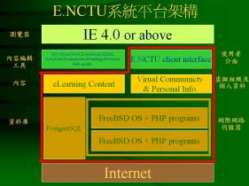 | 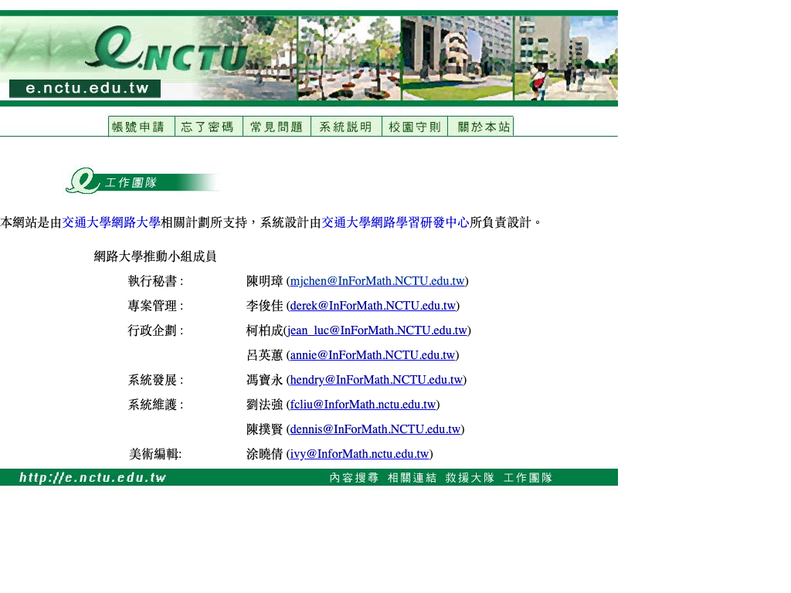 | 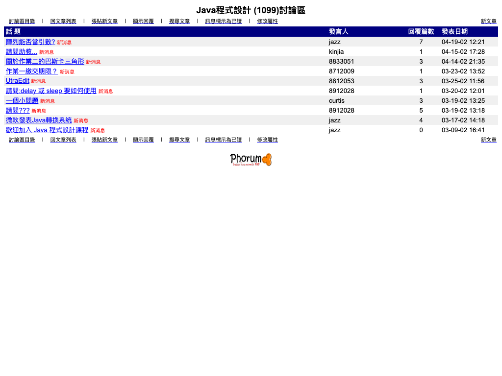 |

---

## 2. E2「eCampus」— `e2.nctu.edu.tw`（2002-09 – 2007-09）

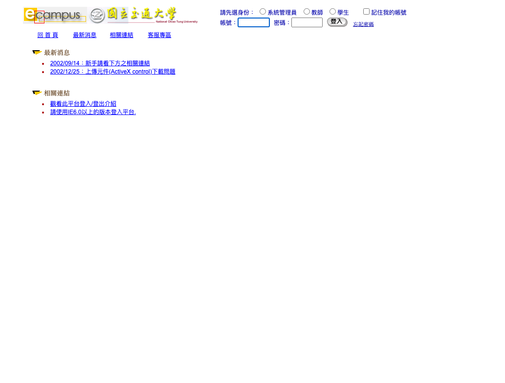
*2003-01 的 e2 登入頁，要先選身份（系統管理員／教師／學生）。來源：[Wayback 2003-01-09](https://web.archive.org/web/20030109212507/http://e2.nctu.edu.tw/eCampus/)*

- **上線**：最早的一則最新消息是 2002-09-14。2002-09-23 公告「本校師生請使用選課系統帳號/密碼登入本系統」。Wayback 第一筆存檔在 2002-10-10，當時根目錄 302 到 `http://140.113.8.88/eCampus/default.aspx`。【確認】
- **技術**：ASP.NET，meta 標示 `Microsoft Visual Studio 7.0`、`C#`；只支援 IE 6.0 以上；上傳檔案要裝 ActiveX「GxWebFtp」元件。【確認】
- **版本號**：2.0.0.312（2003-06）→ 2.2.0.0613（2003-08）→ 4.0.2005.0217（2006–2009）。【確認】
- **同一台主機的其他系統**：「台灣聯合大學網路教學課程選課登錄系統」（`Course/course.asp`，2004），以及外籍生線上申請系統（`/fsreg/`，2006–2007）。【確認】
- **廠商**：頁面上沒有任何廠商字樣。三趨科技的沿革寫 2002 年「交通大學、陽明大學、玄奘大學、中華大學與明新技術學院 e-Campus 五校聯合網路學習平台系統上線」，產品名稱和年份都吻合，所以【推測】E2 就是這套。
- **怎麼和 E3 交接**：e2 的登入頁自己從來沒有公告要轉移，公告是貼在 DCPC 首頁：
  > 2007/08/16「**E2網路教學平台提供服務至九月底止，請教師們轉用E3平台**」……「網路教學平台e-Campus（簡稱e3)：目前已有166位教師選用的e3網路教學平台，已正式上線一年」【確認】
  > 來源：[DCPC 首頁 2007-09-11](https://web.archive.org/web/20070911051426/http://dcpc.nctu.edu.tw/)、[公告內文](https://web.archive.org/web/20070917181422/http://dcpc.nctu.edu.tw/popup.aspx?type=1&id=3e3137da-d804-4c49-a4aa-4ebde347c987)

  實際上 e2 的登入頁到 2009-03 都還開著，只是「沒有最新消息」。
- **巧合**：e2 在 2002 年的 IP `140.113.8.88`，現在是 `video.ocw.nycu.edu.tw`（OCW 影音主機，IIS 10）的 IP。這只是 IP 被重新分配，不代表是同一台機器。

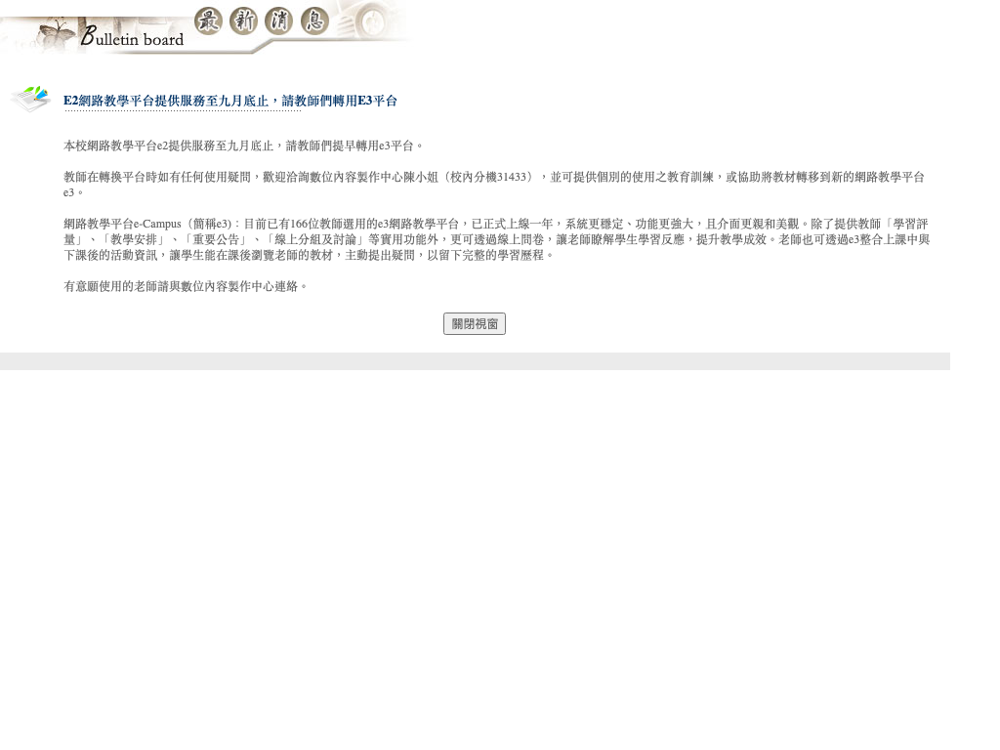

---

## 3. 舊 E3：eCampus III — `e3.nctu.edu.tw`（2006 – 2019）

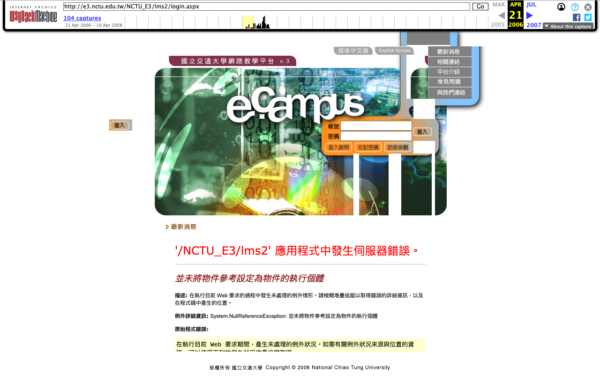
*2006-04 的舊 E3 首版登入頁，橫幅寫「國立交通大學網路教學平台 v.3」加 e-campus 主視覺。來源：[Wayback 2006-04-21](https://web.archive.org/web/20060421232920/http://e3.nctu.edu.tw/NCTU_E3/lms2/login.aspx)*

- **上線**：
  - 最早的存檔在 2006-02-27，標題是 `NCTU E3 (v1.2006.0224.30796)`。
  - 校史館寫 2006 年「e-Campus 3.0（e3）上線，於3月8日、15日在光復校區計網中心電腦教室二舉辦使用說明講解」。
  - 2006-07 起標題改成 `eCampus III v…`。【確認】
- **開發／維運**：教務處**數位內容製作中心**（DCPC），由網路教務組和交大出版社在民國 95 年（2006）合併而成。中心的服務項目寫著「網路教學平台的開發與維運」，公告署名「數位內容製作中心 e3團隊」。【確認】
- **技術**：ASP.NET（Anthem.NET AJAX），伺服器 IIS 6.0（2018 年換成 IIS 8.5）；frameset 加整頁切圖，「本平台目前僅適用IE」。【確認】
- **規模**：「每學期約有1100門課程透過e-Campus輔助教學」。【確認】
- **網址與版本的演進**（版本號會寫在頁面標題裡，附錄列出 60 多個版本）：

  | 期間 | 路徑 | 版本 | 事件 |
  |---|---|---|---|
  | 2006-02 ~ 2009-01 | `/NCTU_E3/lms2/` | v1.1 → v1.4 | 首版 |
  | 2009-02 ~ 2011 | `/NCTU_E3P/LMS2/` | v1.5 | 版本升級 |
  | 2010-09 ~ 2016 | `/NCTU_EASY_E3P/LMS2/` | v1.5，2013-02 之後不再更新 | 2010/09/16 公告「好康訊息！新e3上線」，預設改成簡易介面，「進階設定」要另外開 |
  | 2016-09 ~ 2019 | `/NCTU_EASY_E3P/LMS3/` | 同上 | 只是換部署目錄 |
  | 2018-06 ~ 2019-09 | `/NCTU_EASY_E3P/LMS31/` | — | 換到 IIS 8.5 |

- **入口搬家**：2008-09 起，`e3.nctu.edu.tw/` 直接 302 到 DCPC 首頁，E3 的登入框和公告都放在 DCPC 網站上。很多人記得的「E3 首頁」其實是 DCPC 首頁。【確認】
- **2014/06/27 公告**：「舊版 e3 將於9月1日【停止服務】」。說明附件沒有被存檔，所以不確定指的是哪一版；【推測】是 2010 年以前的 `NCTU_E3P` 介面。
- **行動化**：
  - 2013 年推出「iCT」行動學習平台 App，E3 也有 `mService/service.asmx` 行動 API。
  - 2017/10/11 公告「iNCTU App 下架」。【確認】
- **退場**：
  - 2017/09/27 公告 New E3 網址 `http://e3.nctu.edu.tw/new`，新舊 E3 開始並行。
  - DCPC 首頁之後改寫成「**e3已於107下學期改版／請按此進入New e3使用**」，也就是 2019-02 正式切換。
  - 舊 E3 最後一筆正常存檔在 2019-09-14，2019-09-29 已回 401，2020-10 再被存到時是 404。**正式關站公告沒找到**，關站時間只能確定落在 2019-09-29 ~ 2020-10-25 之間。【確認／推測】
- 合校後的手冊（2022–2025 版）系統選單裡還有一項「**E3 線上學習系統（舊eCampus）**」，說可以用來查舊課程。這是登入後才看得到的入口，從外部查不到網址。

| DCPC 首頁兼 E3 入口（2007） | DCPC 首頁（2012） | 新舊並行期（2018-01） |
|---|---|---|
| 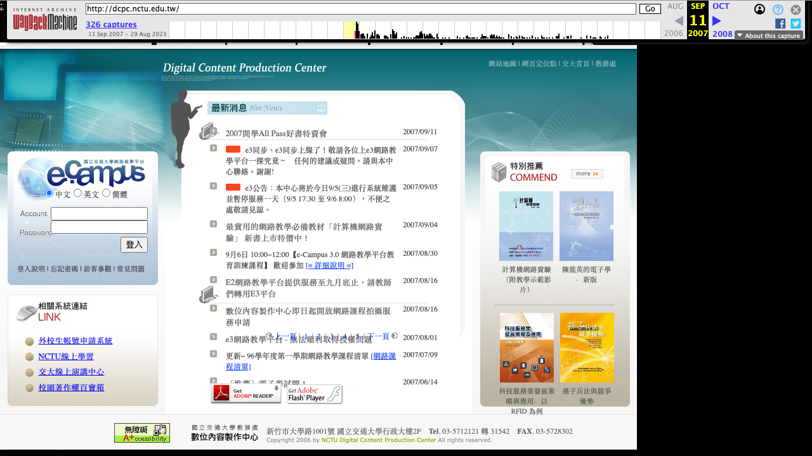 | 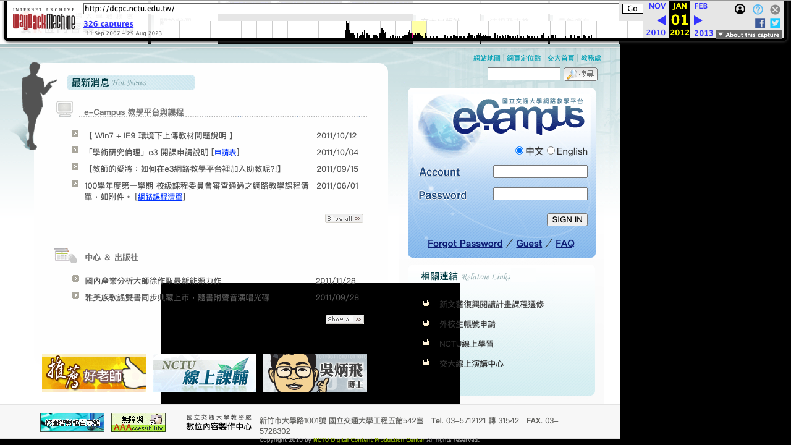 | 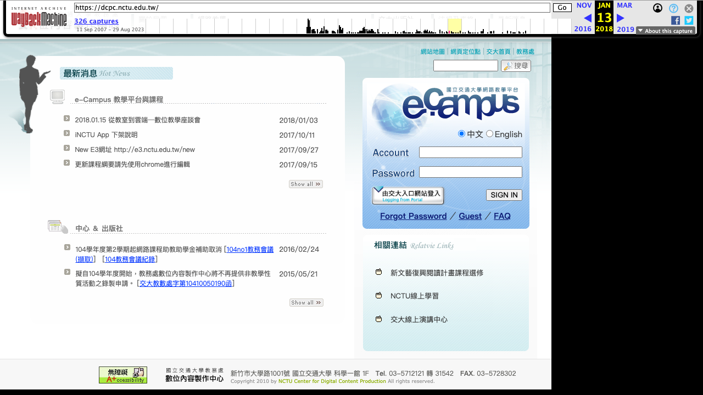 |

---

## 4. New E3 — `e3new.nctu.edu.tw`（2017-09 – 2021-01）

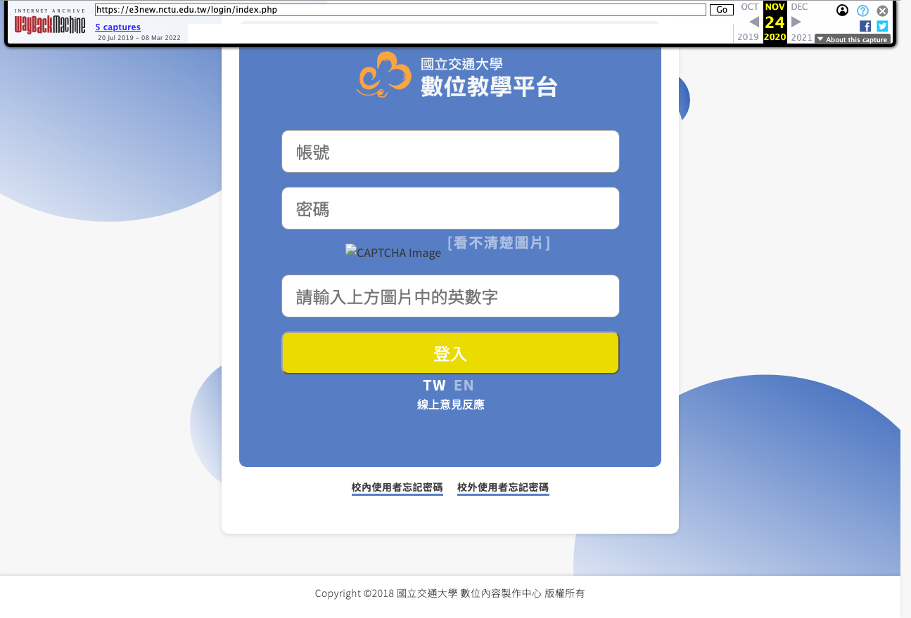
*New e3 登入頁，「國立交通大學 數位教學平台」加橘色雲朵 logo。來源：[Wayback 2020-11-24](https://web.archive.org/web/20201124064122/https://e3new.nctu.edu.tw/login/index.php)*

- **官方定義**（2017/09 版介紹手冊）：「New E3 數位教學平台 是以moodle 為基礎原型，由交通大學數位內容製作中心為校內師生客製化而開發出來的網路學習平台。」手冊裡有「匯入 E3 資源」功能，可以把舊 E3 的教材、作業、公告搬過來。【確認】（PDF：`images/2017-09_NewE3_intro_OperationInstruction.pdf`）
- **技術**：Moodle，自製佈景 **`theme_dcpc`**（dcpc 就是數位內容製作中心的縮寫），外掛有 Google OAuth2，YUI 3.17.2。【確認】
  版本是拿 `M.cfg` 的鍵值去和 Moodle 原始碼比對得到的 **3.3–3.7**；另一個線索是頁面還載入 dock 模組，而 3.7 已移除 dock，所以更可能是 3.3–3.6。【推測】
- 頁尾：「Copyright ©2018 國立交通大學 數位內容製作中心 版權所有」。
- **時程**：
  - 2017-09-27 公布網址。
  - 2019-02 全面改用。
  - 2020-07-28「新版e3」改版，換上新 logo。
  - **2021-01-28 換成維護頁**（「本系統，進行系統維護中 暫停服務」）。
  - 2021-05 起 301 轉到 `e3.nycu.edu.tw`。【確認】
- 陽明大學在 2020-02-17（108 學年第 2 學期）也引進交大 New E3，架在 `newe3.ym.edu.tw`，為合校做準備（見 §7）。

---

## 5. 合校後：`e3.nycu.edu.tw`（2021-01 – ）與 `e3p.nycu.edu.tw`（2024-02 – ）

### 5.1 e3.nycu.edu.tw：e3new 直接搬過來

- e3new 在 2021-01-28 換成維護頁，e3.nycu 的佈景版本日期是 **2021-01-29**，首筆存檔 2021-01-30，比 2021-02-01 合校早幾天。佈景、logo 檔名、版面都和 e3new 一樣，只換了網域和品牌：頁尾改成「Copyright ©2021 國立陽明交通大學 教學資源組」。【確認】
- 2021-08 到 2022-02 之間升級到 Moodle 3.8–3.10【推測】。之後登入頁改成「僅供校外使用者」，校內師生改由單一入口（`portal.nycu.edu.tw/portal/newe3`）登入，校外帳號要用 Google Authenticator 二階段驗證。【確認】
- **2024-02-26 起登入頁的第一行**是 `<meta http-equiv="refresh" content="0; url=https://e3p.nycu.edu.tw/">`，所以瀏覽器一打開就會跳到 e3p。【確認】

| e3.nycu 首日（2021-01-30） | e3.nycu 校外專用登入（2022-12） |
|---|---|
| 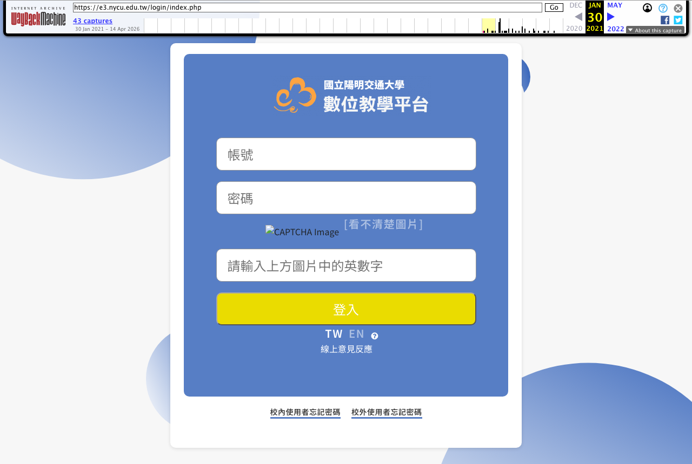 | 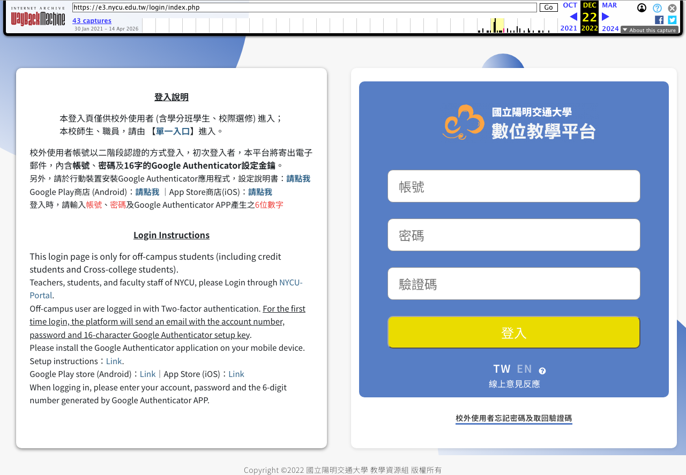 |

### 5.2 e3p.nycu.edu.tw：另建的新站

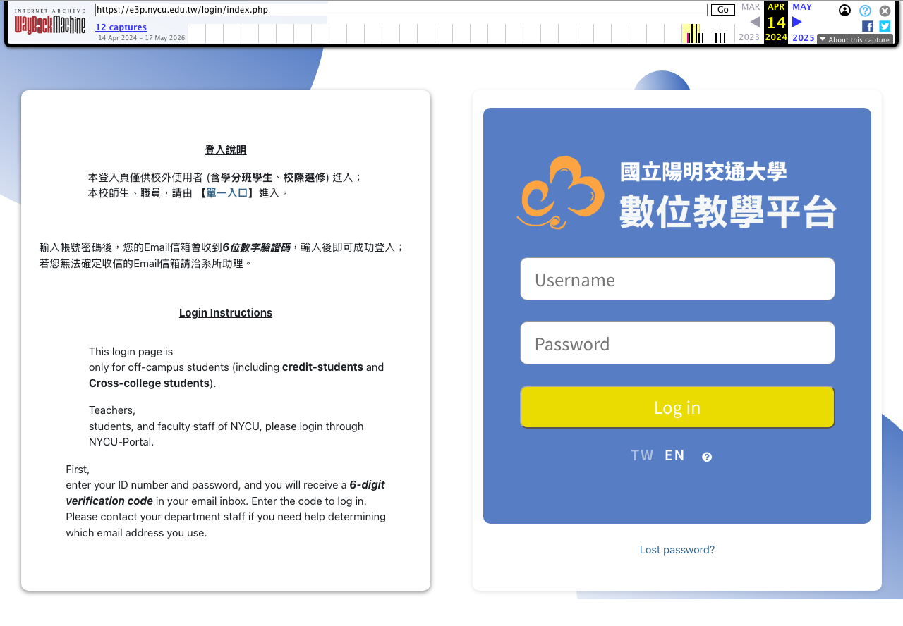
*e3p 最早的存檔（2024-04-14），網站簡稱「E3@NYCU」。*

- **上線**：112 學年第 2 學期（2024-02）。
  - jsrev 是 2024-02-23，e3.nycu 在 2024-02-26 已經開始轉址過來。
  - 官方 YouTube 上有「112學年度第2學期 E3 新版期中工作坊」（2024-03-28/29），以及「從舊E3到新E3一次搬移整門課程」（2024-05-02）。【確認】
  - Dcard（約 2024-01）：「在網址e3後面多打一個p就是了」。
- **不是原地升級**：e3p 和 e3.nycu 兩台主機同時在線、IP 不同，佈景不同（`boost_union` 對 `dcpc`），Moodle 主版本也不同（4.x 對 3.x）。課程要用「備份→還原（合併）」自己搬。【確認】
- **Moodle 版本**：2024-04 約 4.0 → 2024-06 升到 4.1–4.3 → 2025 年中升到 ≥4.5（已有 `mod/subsection`）。【推測，依 M.cfg 鍵值與 YUI 版本】
- **「p」是什麼意思**：**找不到官方說明**。舊 E3 從 2009 年起路徑就叫 `NCTU_E3P`，陽明的 eCampus 也有 `ecampus3p` 路徑，單一入口的代號則是 `newe3p`。所以【推測】「P」是沿用多年的「Plus／新版」習慣，但沒有證據。官方名稱是「E3@NYCU」「E3數位教學平臺」，**「E3+」沒有官方出處**。

---

## 6. 舊 E3 到底是誰寫的？兩種說法

| 支持「三趨科技（3Probe）產品」 | 支持「DCPC 自行開發／持有原始碼」 |
|---|---|
| 三趨官網沿革：2006 年「eCampus Version 3.0 (E3) 非同步網路學習平台上線」「陽明大學eCampus建置上線」 | 交大 E3 的版權圖寫「版權所有 國立交通大學 Copyright © 2006」，存檔中找不到任何廠商名稱 |
| 陽明 `e3.ym.edu.tw` 登入頁寫「Copyright (R) 2006 3Probe. All rights reserved.」 | DCPC 自述服務項目包括「網路教學平台的**開發**與維運」 |
| 產品名稱都叫 eCampus，陽明那套的標題也是 `eCampus III v1.1…` | build 很頻繁，有時幾天就一版，且長達十多年 |
| 陽明 2006–07 年的登入頁甚至直接沿用印著「國立交通大學」的版權圖，表示兩校共用同一個部署來源 | |

**我的判斷**【推測】：核心產品是三趨的 eCampus 3.0（可能從 E2 時代的五校聯合平台就開始合作），交大版本由 DCPC 掛校方版權，並長期客製與建置。要確定的話，可以查政府電子採購網 2005–2006 年「網路教學平台／eCampus／三趨」的決標紀錄，或 94–95 學年度的教務會議紀錄。

---

## 7. 陽明大學端（合校前）

| 平台 | 網址 | 期間 | 來源 |
|---|---|---|---|
| e-Campus 五校聯合平台 | 不詳 | 2002– | 三趨科技沿革（廠商自述） |
| eCampus III | `e3.ym.edu.tw`（`/E3/LMS2` → `/ecampus3/learn` → `/ecampus3p/learn`）→ `portal.ym.edu.tw/eCampus3P/` | 2006-10 → 約 2018 | 標題 `eCampus III v1.1.60807…`，「Copyright 2006 3Probe」【確認】 |
| ee-class 易課平台 | `eeclass.ym.edu.tw` | 2015-05 → 108-2 學期起不再新開課 | FormosaSoft【確認】 |
| New E3（交大 New E3） | `newe3.ym.edu.tw` | 2020-02-17 → 合校 | 陽明教學資源組公告「為因應兩校合併，1082學期引進交大E3New 數位教學平台」（二手，原頁網域已失效） |

2023-09 的 112-1 E3 工作坊投影片寫：「eCampus、eeClass：網站已關閉，需申請取得」「NewE3：newe3.ym.edu.tw（合校前E3資料）」「eCampus、eeClass 服務期限：**116.7.31（2027-07-31）止**」。【確認】（`images/2023-09_E3workshop112-1_p7_old_platforms.png`）
現在 `ym.edu.tw` 底下所有相關主機都是 NXDOMAIN（見 §8）。

---

## 8. 現在還活著的老系統（2026-10-16 實測）

用了兩種方法：

1. **猜名字**：對 157 個主機名做 DNS 和 HTTP 測試，包括 e1/e2/e3old/e3new/moodle/ecampus 等變體，加上 nctu、nycu、ym 三個網域。
2. **全量掃**：把 crt.sh 和 Cert Spotter 的憑證紀錄合併，得到 **3,349 個主機名**（nycu 2,129、nctu 1,144、ym 76）。其中 684 個能解析 DNS，每個都打了 `http://` 和 `https://` 根目錄，再用 Moodle 指紋、平台名稱、頁面標題等特徵分類。結果在 [`data/subdomain-sweep/ct_probe_2026-10-16.tsv`](data/subdomain-sweep/ct_probe_2026-10-16.tsv)。

**結論**：

| 主機 | 狀態 | 說明 |
|---|---|---|
| **`e3.nycu.edu.tw`** | **還活著** | 2021–2024 的 E3。Moodle 還在運作（`x-redirect-by: Moodle`，Web Service 也有回應），只是登入頁 0 秒轉到 e3p，所以你才找不到。最後一次改版是 2024-07-15。**它的 TLS 憑證 2026-10-20 到期**，而 e3p 和 eportfolio 都在 10 月初換了新憑證，只有它沒換，可能快要退役了。 |
| `ocw.nycu.edu.tw` | 在線 | 開放式課程，平台是新的 WordPress，但首頁還放著交大時期的課程，例如 103 學年的微積分。 |
| `video.ocw.nycu.edu.tw` | 在線 | 只顯示 IIS 預設頁；IP 就是 2002 年 e2 用的 `140.113.8.88`。 |
| `eportfolio.nycu.edu.tw` | 在線 | 新版 SPA，不是 2011–2014 年的交大版。 |
| `e`、`e2`、`e3`、`e3new`、`dcpc`、`eportfolio`、`ocw`、`moodle` 等 `*.nctu.edu.tw` | NXDOMAIN | DNS 紀錄已刪除。用 1.1.1.1 和 8.8.8.8 交叉確認過，不是暫時故障。 |
| 所有 `*.ym.edu.tw` 數位學習主機 | NXDOMAIN | 連 `www.ym.edu.tw` 都沒有了。 |

**全量掃描順帶看到的、還活著的交大時代網站**（跟 E3 無關，但符合「老系統還在」）：`farewell.cs.nctu.edu.tw`（NCTUCS Farewell）、`prevexam.dece.nycu.edu.tw`（交大電機考古網站）、`nycusci.math.nycu.edu.tw`（國立交通大學 科學班）、`applycar.nycu.edu.tw`（交通大學派車申請單）、`nol.cs.nycu.edu.tw`、`lattice.phys.nycu.edu.tw`（LFT@NCTU）、`nctu-alumni-voice.sec.nycu.edu.tw`（交大友聲雜誌社）、`calculus.math.nycu.edu.tw`（微積分教學資訊網）等。

**全量掃描的限制**：`e3`、`e3p`、`eportfolio` 用的是 `*.nycu.edu.tw` **萬用字元憑證**，CT 紀錄裡不會出現它們的名字。所以 CT 全掃對「藏在萬用字元底下的主機」是盲的；`e3.nycu` 是靠猜名字和 Wayback 才找到的。曾嘗試從 Common Crawl 索引補主機名（`data/tools/cc_hosts.sh`），但它的伺服器很慢、常回 504，只抓了 17 個批次中的 2 個就停止，**這部分沒有完成，也沒有拿去掃描**。要補的話可以重跑這支腳本。

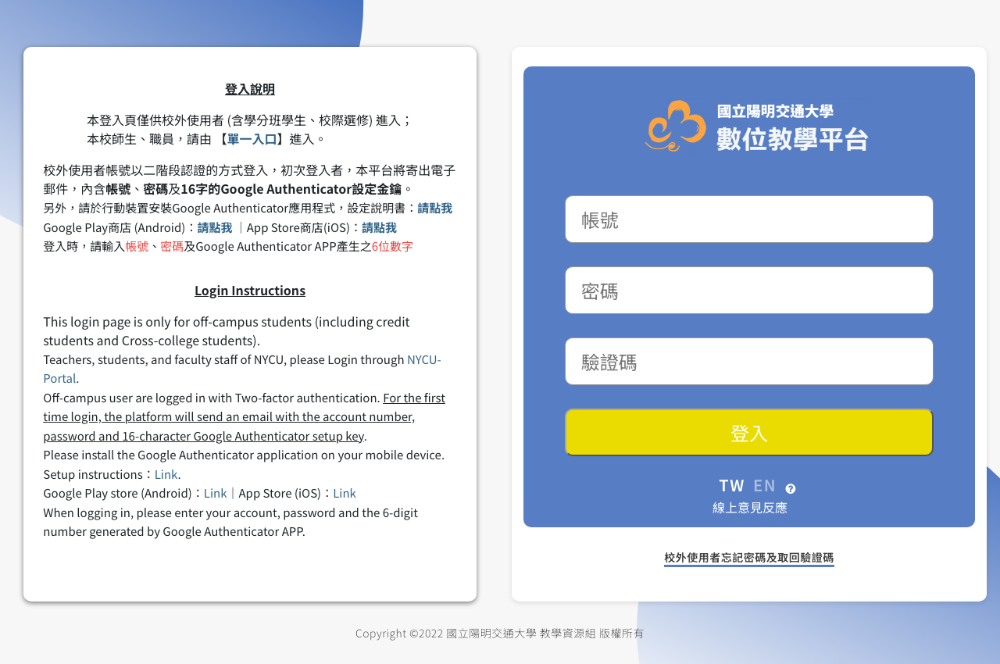
*2026-10-16 的 `e3.nycu.edu.tw` 登入頁原貌。截圖時擋下了往 e3p 的 meta refresh 轉址，頁面內容沒有改動。*

---

## 9. 單位沿革（和 E3 有關的部分）

| 時間 | 單位 | 和 E3 的關係 |
|---|---|---|
| 1998 起 | 理學院「網路學習研究中心」 | 開發 informath、E.NCTU |
| 2000-06 | 網路大學推動小組 | 推動 E.NCTU |
| 2000-11-01 | 教務處「網路教務組」 | E.NCTU、e2 的教務與推廣 |
| 2006（民國 95 年） | 教務處「數位內容製作中心」(DCPC) = 網路教務組 + 交大出版社 | E3、New E3 的開發與維運；Moodle 佈景 `dcpc` 由此得名 |
| 2021 | 陽明交大教務處「教學資源組」 | e3.nycu 頁尾署名 |
| 現在 | 教務處「數位教學中心」 | e3p 維運；聯絡信箱 e3cs@nycu.edu.tw |

---

## 10. 還沒解開的問題

1. 舊 E3（eCampus III）和三趨科技的分工：可以查採購紀錄或教務會議紀錄（§6）。
2. E2 是否就是三趨的五校 e-Campus：頁面上沒有廠商字樣。
3. 舊 E3 的正式關站日：只能確定在 2019-09-29 到 2020-10-25 之間。
4. 2014-09-01 停用的「舊版 e3」到底是哪一版。
5. e3p 的「p」是什麼意思。
6. 「E3 線上學習系統（舊eCampus）」的實際網址：要登入 E3 後看系統選單。
7. 以 E3 為研究對象的學位論文：機構典藏 API 沒有命中，臺灣博碩士論文系統沒辦法自動查詢。

---

## 11. 檔案結構

```
nctu-e3-history/
├── README.md                這份總整理
├── gallery.html             圖庫（離線可開，依年代排列）
├── images/                  68 個檔案：Wayback 截圖、原始 logo／版權圖、手冊頁、現況截圖
├── notes/
│   ├── 01_docs_news.md      文獻、新聞、校史館、手冊、YouTube、GitHub（28 條來源）
│   ├── 02_wayback_e_e2.md   E.NCTU 與 e2 的存檔考古（頁面原文摘錄、團隊名單）
│   ├── 03_wayback_e3_e3p.md 舊 E3 到 e3p（版本序列、Moodle 版本比對表）
│   └── 04_live_probe.md     2026-10 實測：DNS、HTTP、CT 憑證、截圖方法
└── data/
    ├── cdx/                 各主機的 Wayback CDX 索引（timestamp url status mime）
    ├── subdomain-sweep/     CT 主機名清單與全量探測結果（TSV）
    ├── manuals/             教務處 E3 手冊與工作坊投影片 PDF
    └── tools/               探測與分類用的腳本
```

## 12. 主要來源

- 交大校史館：[1991–2000](https://museum.lib.nycu.edu.tw/?page_id=938)、[2001–2010](https://museum.lib.nycu.edu.tw/?page_id=940)、[2011–現今](https://museum.lib.nycu.edu.tw/?page_id=942)
- E.NCTU〈Profile of E.NCTU〉：[2001-03](https://web.archive.org/web/20010302091059/http://e.nctu.edu.tw/news/Profile.htm)、[2003-12](https://web.archive.org/web/20031204104846/http://e.nctu.edu.tw/news/Profile.htm)
- e2 eCampus 登入頁 [2002-10-10](https://web.archive.org/web/20021010082927/http://e2.nctu.edu.tw:80/eCampus/default.aspx)
- 舊 E3 首版 [2006-02-27](https://web.archive.org/web/20060227235201/http://e3.nctu.edu.tw:80/NCTU_E3/lms2/Default.aspx)
- DCPC 首頁：[2007-09-11](https://web.archive.org/web/20070911051426/http://dcpc.nctu.edu.tw/)（E2 停用公告）、[2010-10-21](https://web.archive.org/web/20101021205425/http://dcpc.nctu.edu.tw:80/)（新 e3 上線）、[2014-07-07](https://web.archive.org/web/20140707004421/http://dcpc.nctu.edu.tw/)（舊版 e3 停用）、[2017-12-19](https://web.archive.org/web/20171219093122/http://dcpc.nctu.edu.tw/)（New E3 網址）、[2020-05-26](https://web.archive.org/web/20200526020638/https://dcpc.nctu.edu.tw/)（107 下改版）
- DCPC〈關於我們〉[2007](https://web.archive.org/web/20070917181432/http://dcpc.nctu.edu.tw:80/aboutus_01.htm)
- 三趨科技沿革：http://www.3probe.com.tw/about_milestone.aspx
- 《New E3 數位教學平台介紹》2017/09 版：`https://e3.nycu.edu.tw/theme/dcpc/doc/OperationInstruction/`
- e3new 維護頁 [2021-01-28](https://web.archive.org/web/20210128080940/https://e3new.nctu.edu.tw/)、e3.nycu 首日 [2021-01-30](https://web.archive.org/web/20210130053020/https://e3.nycu.edu.tw/login/index.php)、e3p 首次存檔 [2024-04-14](https://web.archive.org/web/20240414071219/https://e3p.nycu.edu.tw/login/index.php)
- 教務處【E3 問答集】教師篇（110-02-24）、112-1 E3 工作坊投影片（2023-09）、E3 使用手冊（2022–2025）：見 `notes/01_docs_news.md` 的 [S18]、[S19]、[S26]
- 完整來源清單：`notes/01_docs_news.md` §9、`notes/02_wayback_e_e2.md` §6、`notes/03_wayback_e3_e3p.md` §5
